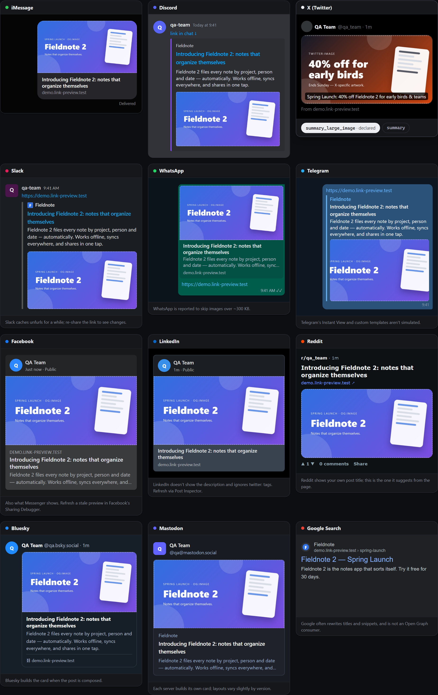
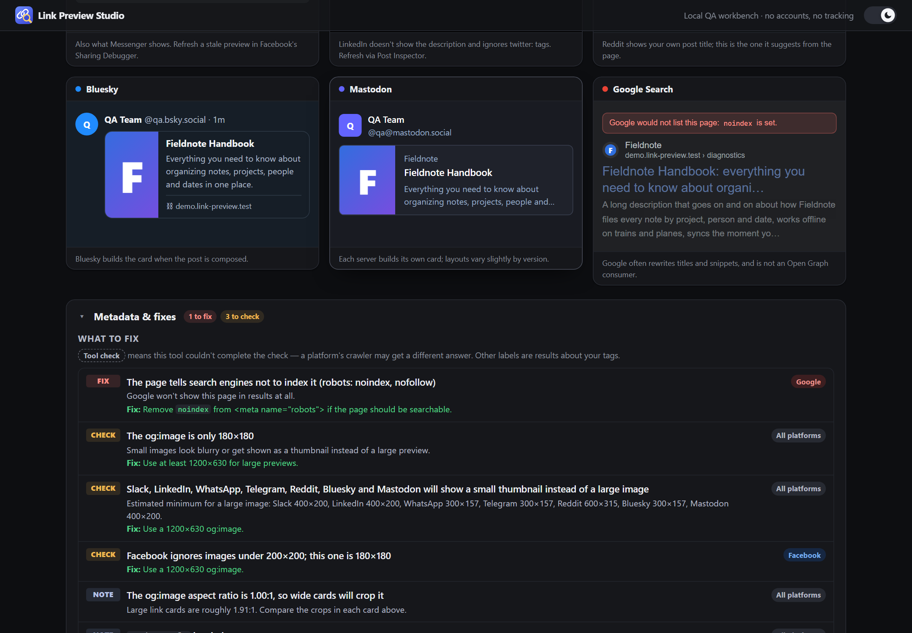
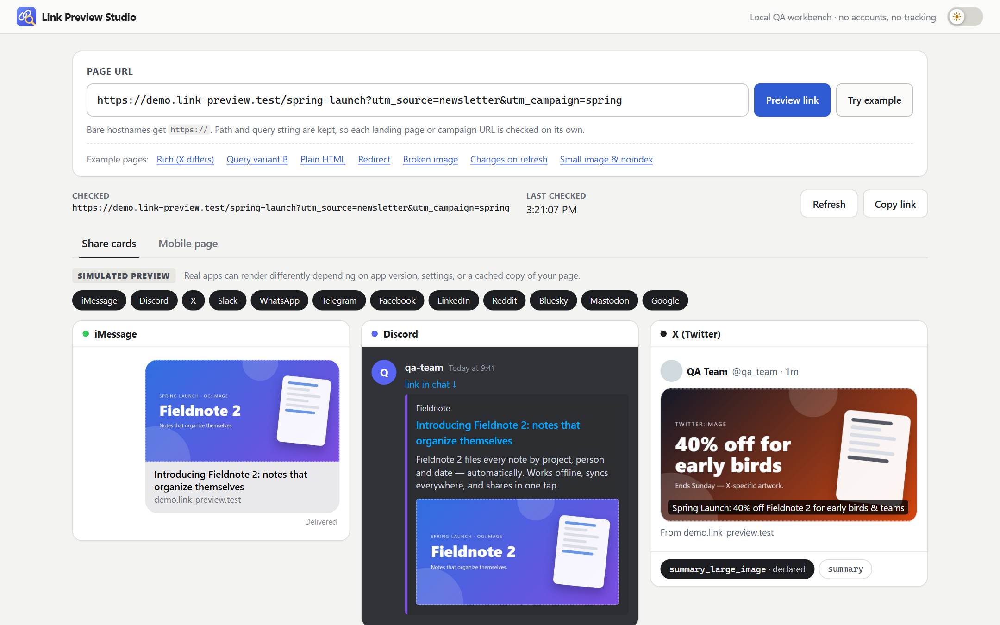
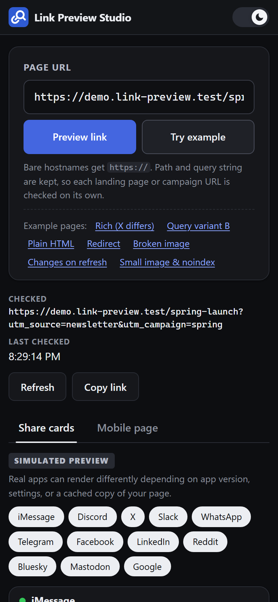

<div align="center">


# Link Preview Studio

**See your link the way people will before they share it.**

A local QA workbench for link previews. Paste a URL and see simulated share cards for 12 platforms, a real phone screenshot of the page, and a prioritized list of tags to fix.

[](https://github.com/ztxv/link-preview/actions/workflows/check.yml)


[](LICENSE)

[](https://vercel.com/new/clone?repository-url=https%3A%2F%2Fgithub.com%2Fztxv%2Flink-preview&env=LPS_SECRET&envDescription=Random%20secret%20used%20to%20sign%20preview%20image%20URLs&envLink=https%3A%2F%2Fgithub.com%2Fztxv%2Flink-preview%23deploy-to-vercel)

[Quick start](#quick-start) &nbsp;·&nbsp; [Deploy to Vercel](#deploy-to-vercel) &nbsp;·&nbsp; [Platforms](#how-the-cards-are-simulated) &nbsp;·&nbsp; [Safe fetching](#safe-fetching) &nbsp;·&nbsp; [Development](#development)

</div>

<p align="center">
  
</p>

---

## About

Open Graph and Twitter Card tags decide what your page looks like when it's pasted into a chat or a feed, and every platform reads them a little differently. Link Preview Studio fetches your page the way a crawler would, then shows each platform's likely card side by side, with the exact tag or fallback behind every field and a short list of what to fix. Everything runs on your machine or your own deployment: no accounts, no database, no paid APIs, no analytics.

## Features

- **12 simulated cards.** iMessage, Discord, X (Twitter), Slack, WhatsApp, Telegram, Facebook/Messenger, LinkedIn, Reddit, Bluesky, Mastodon and a Google Search result, each with its own image crop, text wrapping and fallback rules. Platform chips hide the ones you don't care about.
- **Metadata & fixes.** Which tag each card used (or which fallback), measured image sizes, prioritized issues labeled by platform, and a copyable snippet of suggested Open Graph / Twitter Card tags.
- **Hand it to your AI.** One click copies a brief for a coding agent (Claude Code, Cursor, Codex) or for a chat assistant (Claude, ChatGPT): every issue, what the page declares today, and the tags to aim for. No more screenshots. Text read from the page is flattened and labeled as data, so a hostile page can't inject instructions.
- **Real phone screenshots.** iPhone (WebKit) and Android (Chromium) presets, taken by an isolated Playwright worker. Optional: the cards work without it.
- **Per-URL accuracy.** Path and query string are kept, so each landing page or campaign URL is checked on its own. Redirects are followed and reported.
- **Safe by design.** Public http(s) only, enforced at connection time; images are validated and re-served through opaque tokens. See [Safe fetching](#safe-fetching).
- **Dark by default.** Light-mode switch in the top bar (saved locally, applied before first paint), smooth theme transitions, and animation that respects `prefers-reduced-motion`.
- **Offline demo.** A bundled example site at `demo.link-preview.test` is answered in-process, so you can explore every state without the network.

<p align="center">
  
</p>

<p align="center">
  
  &nbsp;
  
</p>

## Quick start

Requires Node.js 22.18+ (developed on Node 24; the worker runs `.ts` files directly using Node's type stripping).

```bash
git clone https://github.com/ztxv/link-preview.git
cd link-preview
npm ci
npm run browsers:install   # one-time: Playwright Chromium + WebKit (~250 MB), only needed for phone screenshots
npm run dev                # Next.js on http://localhost:3000 + capture worker on 127.0.0.1:4410
```

Open <http://localhost:3000> and press **Try example**. The bundled example works offline.

| Command | What it runs |
| --- | --- |
| `npm run dev` / `npm start` | Web app and capture worker together (dev / production) |
| `npm run dev:web` / `npm run start:web` | Web app only (no phone screenshots) |
| `npm run worker` | Capture worker only |
| `npm run build` | Production build |

## Deploy to Vercel

The app deploys to Vercel as-is. Share cards, the inspector and the bundled example all work on serverless.

1. Click **Deploy with Vercel** above, or import the repository from the dashboard.
2. Set one environment variable, **`LPS_SECRET`**, to a long random string:
   ```bash
   node -e "console.log(require('crypto').randomBytes(32).toString('base64url'))"
   ```
   It signs the opaque `/api/image/<token>` URLs. Serverless runs several instances, so without a shared secret each one makes its own key and preview images fail intermittently.
3. Deploy. No other configuration is needed (Next.js preset, Node 22+, `npm run build`).

What to expect on Vercel:

- **Phone screenshots are off.** A Playwright browser can't run inside a serverless function, so on Vercel the Mobile tab says capture is unavailable and offers **Open original**. To keep screenshots, run the worker elsewhere (a container or VM with an egress firewall) and set `CAPTURE_WORKER_URL` and `CAPTURE_WORKER_TOKEN`. See [Mobile capture](#mobile-capture).
- **Function limits.** `/api/preview` is allowed up to 60 s and `/api/image/[token]` up to 30 s. Each page fetch is bounded to 10 s, so slow sites fail with a readable message.
- **It is a public fetcher.** Destinations are restricted to public addresses, but there is no per-client rate limiting. Put Vercel's firewall or rate limiting in front of it if the deployment is open to everyone.

## Bundled example

The example site lives at `https://demo.link-preview.test`. `.test` is a reserved TLD that never resolves publicly, and requests for that one host are answered in-process from `src/lib/demo/site.ts` (by both the fetcher and the capture worker), so the example never touches the network. Pages:

| Path | Shows |
| --- | --- |
| `/spring-launch?utm_source=…` | Rich OG + Twitter tags; X title/description/image deliberately differ from OG; two `og:image` entries |
| `/spring-launch?variant=b` | Same path, different query string → different metadata |
| `/plain` | Only a `<title>` and favicon — fallbacks and placeholders |
| `/old-launch` | 301 redirect to the rich page |
| `/broken-image` | Relative `og:image` that returns 403, no `twitter:card` |
| `/changing` | Metadata changes on every fetch — use **Refresh** |
| `/diagnostics` | 180×180 `og:image`, `robots: noindex`, very long title/description, Slack `twitter:label` tags, no `fb:app_id` / `fediverse:creator` |

Images are generated by `npm run assets:demo` and embedded in `src/lib/demo/assets.ts`.

## How the cards are simulated

The cards are platform-*inspired* simulations, not screenshots of the real apps. **The field-selection and layout rules below are estimates** based on public documentation and observed behaviour; real apps change between versions, depend on user settings, and often show a cached copy of your page. The UI says so above the cards.

**iMessage (estimate)**
- Title: `og:title` → `<title>` → hostname.
- Rich layout when the first `og:image` loads and is at least ~200×100; the image keeps its aspect ratio, clamped between 1:1 and 2:1.
- Otherwise a compact bubble with `apple-touch-icon` → favicon (or a small `og:image` as the thumbnail); otherwise a plain bubble.
- Description is not shown.

**Discord (estimate)**
- Site name: `og:site_name` only.
- Title: `og:title` → `twitter:title` → `<title>`.
- Description: `og:description` → `twitter:description` → `meta description` (clamped to 4 lines here).
- Image: first `og:image` → `twitter:image`. Large image when `twitter:card` is `summary_large_image`, otherwise an 80×80 thumbnail on the right. Large images are scaled to fit (max ~400×300), not cropped.
- Accent edge colour: `theme-color`.

**X (estimate)**
- `twitter:` fields first, with the matching Open Graph field as fallback: `twitter:title` → `og:title`, `twitter:description` → `og:description`, `twitter:image` → first `og:image`. X does not fall back to `<title>` here.
- Both `summary` (square thumbnail, 1-line title, 2-line description) and `summary_large_image` (1.91:1 crop with title overlay and "From domain") can be viewed with the toggle.
- If `twitter:card` is missing or not `summary`/`summary_large_image` (e.g. `player`, `app`, or a typo), the card is labeled **Estimated**, the missing/unsupported tag is flagged, and the fallback type is `summary_large_image` when the image is at least 300×157, else `summary`.

**Slack (estimate)**
- Title: `og:title` → `twitter:title` → `<title>`; description likewise; image: `og:image` → `twitter:image`.
- Site name: `og:site_name`, else the domain, next to the favicon. `twitter:label1/data1` and `label2/data2` are shown as small fields.
- Large image when `twitter:card` is `summary_large_image` (thumbnail for `summary`); with no `twitter:card`, large from 400×200.

**WhatsApp (estimate)**
- Open Graph only: `og:title` → `<title>`, `og:description` → meta description, `og:image` (no `twitter:image`).
- Large image from 300×157, otherwise a thumbnail. Images over ~300 KB are flagged because WhatsApp is reported to skip them.

**Telegram (estimate)**
- Same fallbacks as Slack. Site name in the accent colour, image large from 300×157. Instant View isn't simulated.

**Facebook / Messenger (estimate)**
- Open Graph only. Large image from 600×315, thumbnail down to 200×200, ignored below that. `fb:app_id` is reported as optional.

**LinkedIn (estimate)**
- Open Graph only (`og:title` → `<title>`, `og:image`); the description isn't shown. Large image from 400×200, otherwise a thumbnail.

**Reddit (estimate)**
- Shows the suggested post title (`og:title` → `twitter:title` → `<title>`), the domain, and the image as a card (600×315+) or thumbnail. No description.

**Bluesky (estimate)**
- Title, description and image with the Slack fallbacks; large image from 300×157.

**Mastodon (estimate)**
- `og:title`, `og:description`, `og:site_name` as the provider, `og:image` → `twitter:image`; large image from 400×200. `fediverse:creator` becomes the "By …" line.

**Google Search (estimate)**
- Title: `<title>` → `og:title`; description: meta description → `og:description`. Cut near 60 / 160 characters. `robots: noindex` is flagged as an error. No image. Google often rewrites titles and snippets.

The thresholds above are constants in `src/lib/preview/cards.ts` (`LARGE_IMAGE_MIN` and friends).

## Metadata & fixes panel

- Issues are sorted Fix → Check → Note and labeled with what they affect: **All platforms** (a problem in your tags), a platform name (a platform-specific result), or **Tool check** (this tool couldn't complete the check — e.g. "The preview image returned HTTP 403 to this tool" — a platform's crawler may get a different answer).
- The full, untruncated text of every field is shown with its source tag or fallback.
- `og:image` entries are listed in document order with their own `width`/`height`/`type`/`alt`/`secure_url`, plus measured dimensions, format and size.
- The canonical URL and `og:url` are shown as *reported* metadata; the tool always inspects the URL you submitted (after redirects).
- **Hand this to your AI** copies a ready-made prompt (coding-agent or chat version) listing the issues for the platforms you have selected, the page's current values and the tags to aim for. The source is `src/lib/preview/prompt.ts`.
- **Copy suggested tags** generates HTML-escaped OG + Twitter tags from known values. Unknown values become lines marked `PLACEHOLDER`. Merge the snippet into your page's existing `<head>` rather than appending duplicates.

## Safe fetching

All submitted URLs, redirect targets and page-provided asset URLs are untrusted (`src/lib/net`).

- **Public http(s) only.** Schemes other than http/https, embedded credentials, ports other than 80/443/8080/8443, `localhost`, single-label names and internal suffixes (`.local`, `.internal`, `.home.arpa`, …) are rejected.
- **Enforced at connection time.** DNS resolution happens inside the socket's `lookup` hook; if *any* answer is private, loopback, link-local, CGNAT, multicast, documentation, benchmarking, reserved, IPv4-mapped/NAT64/6to4/Teredo, or outside IPv6 global unicast, the connection is refused. The socket connects to exactly the address that was checked, and the peer address is checked again before any response is read (no DNS-rebinding gap). Literal IPs are checked directly.
- **Every redirect is re-validated** (max 5).
- **Bounded:** 10 s per page (8 s per image), 3 MB of decompressed HTML (later bytes are ignored and flagged), 8 MB per image, max 6 images per check, 8 concurrent outbound requests per process.
- **Anonymous:** no cookies, no auth headers, no referrer; one identifiable user agent.
- **Rendered as text:** metadata is rendered with React text nodes only — never as HTML.
- **Validated images only:** the browser never loads page assets directly. The preview API returns opaque AES-GCM tokens; `/api/image/<token>` only fetches URLs the server discovered itself (so it isn't an open proxy), decodes the bytes, serves only PNG/JPEG/GIF/WebP/AVIF/BMP/ICO with a MIME type derived from the bytes, and adds `nosniff` and a sandboxing CSP. SVG is refused.
- **No raw URLs in logs:** the page URL travels in a POST body, image URLs are encrypted in tokens, and server/worker log lines contain only outcome codes and timings. There is no analytics.

## Mobile capture

`worker/capture-worker.ts` is a separate Node process (default `127.0.0.1:4410`) that the Next.js app calls via `/api/capture`.

Per capture it:

- starts a **fresh browser context** (no cookies, storage, cache or permissions) on a long-lived Chromium or WebKit process;
- routes **all browser traffic through a per-capture egress proxy** (`worker/egress-proxy.ts`) that resolves and checks every destination — page, subresources, redirects and HTTPS `CONNECT` tunnels — and connects only to the checked public IP; Chromium's implicit loopback proxy bypass is disabled, and request routing also aborts non-public URLs before they leave the browser;
- disables WebSockets, service workers, downloads, popups, dialogs and WebRTC;
- enforces hard limits: 15 s navigation, 30 s total, 400 requests, 30 MB, 5 000 CSS-px page height, 2 concurrent captures with a queue of 4.

Presets (Playwright device descriptors):

| Preset | Viewport | DPR | Engine |
| --- | --- | --- | --- |
| iPhone 15 | 393×659 | 3 | WebKit |
| Pixel 7 | 412×839 | 2.625 | Chromium |

The UI shows the screenshot in a scrollable phone frame labeled **Browser emulation**, with viewport, DPR, engine and version.

Configuration:

| Variable | Where | Default | Purpose |
| --- | --- | --- | --- |
| `CAPTURE_WORKER_URL` | Next.js | `http://127.0.0.1:4410` | Worker address. Set to `off` when no worker is deployed. |
| `CAPTURE_WORKER_TOKEN` | both | — | Shared secret sent as `x-capture-token` (set it if the worker is reachable by anything other than the app). |
| `CAPTURE_WORKER_PORT` / `CAPTURE_WORKER_HOST` | worker | `4410` / `127.0.0.1` | Listen address. |
| `CAPTURE_MAX_CONCURRENT` | worker | `2` | Parallel captures. |
| `LPS_SECRET` | Next.js | random per process | Key for image tokens. Set it when running more than one app instance. |
| `LPS_MAX_CONCURRENT_FETCHES` | Next.js | `8` | Outbound fetch concurrency. |

**Deployments without the worker** (for example a serverless host): set `CAPTURE_WORKER_URL=off`. On Vercel this is automatic when `CAPTURE_WORKER_URL` is unset. The Mobile tab then says capture is unavailable and offers **Open original**; the share cards and inspector work normally. If the worker is unreachable for any other reason, the UI shows the same fallback.

## Development

```bash
npm run check       # eslint + tsc + unit/integration tests (vitest)
npm run test:e2e    # next build + Playwright end-to-end tests (own servers on :3100 and :4411)
```

- **Unit / integration (`tests/unit`, 120 tests):** the fetch → parse → image check → cards → issues pipeline over real sockets against a local fixture server (redirect chains, query variants, broken images, gzip, legacy charsets, truncation, timeouts, loops), per-platform field fallbacks and image-size layouts, escaped suggested tags, the destination policy across IPv4/IPv6 private and reserved ranges, connection-time enforcement, and the capture worker's egress proxy.
- **End-to-end (`tests/e2e`, 19 tests):** the real UI against a production build: cards side by side and stacked at phone width, a card for every platform with working chips, copy buttons, blocked destinations, real screenshots from both mobile presets, the capture-unavailable fallback, the AI prompt copy buttons, and the dark-by-default theme toggle.

CI runs `npm run check` and `npm run build` on every push and pull request.

```
src/app/                 App Router page, icons and API routes (/api/preview, /api/image/[token], /api/capture)
src/components/          Workbench, cards (CardsView + PlatformCards), inspector, mobile panel, theme toggle
src/lib/net/             Destination policy and guarded fetcher (shared with the worker)
src/lib/preview/         Parser, image checks, card rules, issues, suggested tags
src/lib/demo/            Bundled example site and embedded images
src/lib/capture/         Device presets
worker/                  Capture worker and egress proxy
scripts/                 Demo asset generator
tests/unit, tests/e2e    Vitest and Playwright suites
docs/screenshots/        README images
```

## Limitations

- **Simulations, not the real apps.** Card rules are estimates (see above). Platforms also use their own crawlers and user agents; sites that serve different HTML to specific bots, geo-block, or use bot protection may give platforms a different result than this tool. Such cases are labeled "Tool check" where possible.
- **Initial server HTML only.** Tags injected by client-side JavaScript are not seen — which matches most link-preview crawlers.
- **WebKit on Windows.** Playwright's Windows WebKit build doesn't support `isMobile` and can't verify many public HTTPS certificates. On Windows the iPhone preset still uses WebKit's viewport/DPR/UA emulation, and when WebKit rejects a certificate the capture is retried once in Chromium with the iPhone viewport and UA — the result is clearly labeled with the engine actually used. On macOS and Linux WebKit captures work directly. In both cases this is browser emulation, not Safari or Chrome on a real phone.
- **Isolation is process-level.** The worker enforces public-only egress itself, but for an internet-facing deployment also run it in a container/VM with an egress firewall that blocks private ranges and cloud metadata, and set `CAPTURE_WORKER_TOKEN`.
- **No per-client rate limiting** — only global concurrency limits. Add rate limiting before exposing the app publicly.
- **No outbound proxy support.** The fetcher connects directly and ignores `HTTP(S)_PROXY`, so networks that require a proxy won't work.
- **Ports** are limited to 80, 443, 8080 and 8443.
- Only the first 4 `og:image` entries plus `twitter:image` and icons are fetched and measured; very long pages are screenshotted down to 5 000 CSS px.
- Image tokens expire after an hour; without `LPS_SECRET` they don't survive a server restart (press Refresh).

## License

[MIT](LICENSE)
